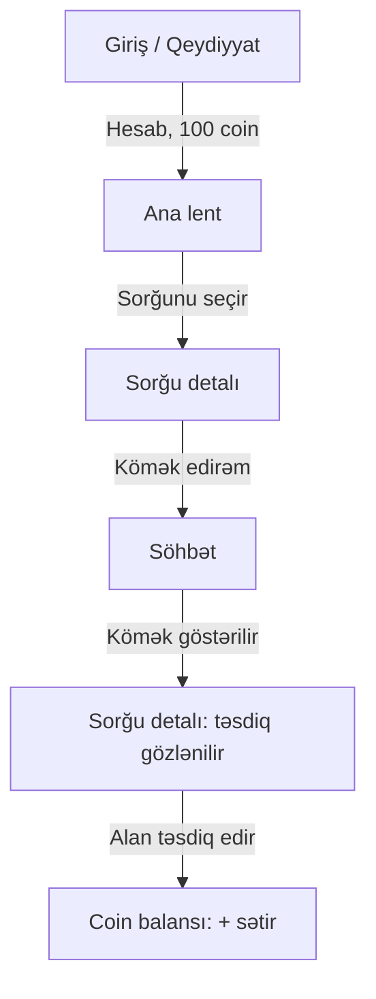
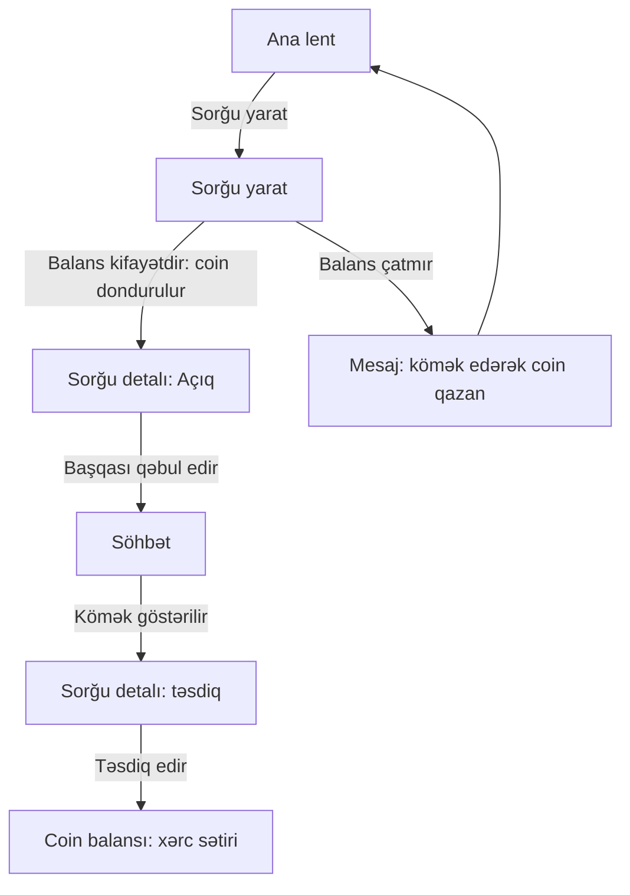
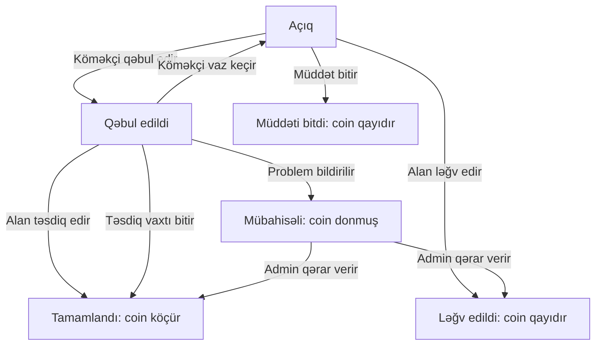

# Tələbə Coin: MVP planı

> Planlaşdırma sənədidir, kod yoxdur. Coinlərin real pul dəyəri yoxdur. Coin investisiya, qazanc vasitəsi və ya kripto deyil, yalnız tətbiqdaxili hesab vahididir.

## 1. İstifadəçi və əsas problem
Eyni adam həm kömək edən, həm kömək alan ola bilər. Rol hesaba yox, hər sorğuya bağlıdır.

| Rol | Əsas ehtiyac |
|---|---|
| Kömək edən | Bildiyi mövzunu izah edib coin qazanmaq, uyğun sorğunu tez tapmaq. |
| Kömək alan | Anlamadığı mövzuda tez və başa düşülən kömək tapmaq, coini nəyə xərclədiyini görmək. |

**Problem:** tələbə çətin mövzuda kimə yaxınlaşacağını bilmir. Bilən tələbənin isə köməyi göstərmək üçün görünən qarşılığı yoxdur.

## 2. MVP funksiyaları
Sual: "bu olmadan əsas dəyər işləyirmi?" Əsas dəyər: biri kömək edir, coin alır, başqası coinlə kömək alır.

| # | Funksiya | Niyə lazımdır | Prioritet |
|---|---|---|---|
| 1 | Qeydiyyat/giriş + minimal profil (ad, universitet, kurs) | Coin hesaba bağlıdır | Mütləq |
| 2 | Kömək sorğusu yaratmaq (fənn, mövzu, təsvir, qiymət) | Sorğu olmasa alan tərəf yoxdur | Mütləq |
| 3 | Açıq sorğular lenti (fənnə görə filtr) | Köməkçi sorğunu tapmalıdır | Mütləq |
| 4 | "Kömək edirəm" demək | Tərəflərin bağlanması | Mütləq |
| 5 | Sorğu daxili mətn söhbəti | Razılaşma və mübahisədə iz | Mütləq |
| 6 | Coin dondurma və köçürmə | Sistemin özüdür; dondurma olmasa alan qaça bilər | Mütləq |
| 7 | Tamamlama təsdiqi və ləğv | Coinin nə vaxt köçdüyünü müəyyən edir | Mütləq |
| 8 | Coin balansı və tarixçə | Şəffaflıq qaydası | Mütləq |
| 9 | "Problem bildir" (admin əl ilə baxır) | Etibar və təhlükəsizlik | Mütləq (minimal) |
| 10 | Push bildirişlər | Olmasa da işləyir, ilk vaxt tətbiqdaxili göstərici kifayətdir | Sonra |
| 11 | Qarşılıqlı rəy və reytinq | Olmadan da kömək işləyir | Sonra |
| 12 | Admin panel | Verilənlər bazasının öz paneli kifayətdir | Çıxarıldı |
| 13 | Coin hədiyyə / birbaşa köçürmə | Sui-istifadə yolu açır | Çıxarıldı |

**Cəmi 9 mütləq funksiya.**

**İlk sürümdə qəsdən olmayacaq:** liderbord və nişanlar (yarış motivasiyası, əsas dəyər deyil); coin alışı və ya real pula çevirmə (coinlərin pul dəyəri yoxdur, qayda dəyişməməlidir); video/səsli zəng və fayl göndərmə (mətn kifayətdir); axtarış və kateqoriya ağacı (az sorğuda filtr işləyir); çoxdilli və tünd rejim; qrup sorğuları; avtomatik mübahisə həlli (pilotda əl ilə).

## 3. Coin qaydaları (MVP)
Rəqəmlər nümunədir, qərar sənindir (bölmə 7).
- **Başlanğıc:** hər hesab 100 coinlə başlayır (tarixçədə ilk sətir).
- **Qazanma:** yalnız bir yolla: sorğu tamamlanıb alan təsdiq edəndə köməkçi sorğunun qiymətini alır.
- **Xərcləmə:** yalnız sorğu qiymətinə.
- **Dondurma:** sorğu yaradılanda qiymət alanın balansında dondurulur.
- **Əlçatan balans** = ümumi balans − dondurulmuş coin.
- **Balans çatmadıqda:** sorğu yaranmır. Mesaj: "Əlçatan coinin [N], sorğu qiyməti [M]. Başqa tələbəyə kömək edərək coin qazana bilərsən."
- **Qaytarma:** ləğv və ya cavabsız qalan sorğuda dondurulmuş coin geri qayıdır.
- **Tarixçə:** başlanğıc, qazanc, xərc sətirləri (tarix, sorğu başlığı, məbləğ). Dondurma ayrıca sətir deyil, "Gözləyən" kimi göstərilir.
- **Qapalı sistem:** yeni coin yalnız ilk 100 ilə yaranır, qalanı istifadəçilər arasında köçür.

## 4. Ekran siyahısı (7 ekran)
| # | Ekran | Məqsəd | Əsas elementlər | Rol |
|---|---|---|---|---|
| 1 | Giriş / Qeydiyyat | Hesab | E-poçt, parol və ya kod, ad, universitet, kurs, qaydalarla razılıq, 100 coin xəbəri | Hamı |
| 2 | Ana lent | Sorğuları görmək | Tab: "Açıq sorğular" / "Mənim fəaliyyətim", fənn filtri, sorğu kartı, balans, "Sorğu yarat" | İkisi |
| 3 | Sorğu yarat | Kömək istəmək | Fənn, başlıq, təsvir, qiymət, əlçatan balans | Alan |
| 4 | Sorğu detalı | Sorğunu idarə etmək | Təsvir, status, tərəflər, statusa görə düymə: Kömək edirəm / Söhbət / Təsdiq et / Ləğv et / Problem bildir | İkisi |
| 5 | Söhbət | Razılaşmaq | Mətn söhbəti, sorğu başlığı, status zolağı | İkisi |
| 6 | Profil | Məlumat, çıxış | Ad, universitet, kurs, kömək edə biləcəyim fənlər, çıxış | Hamı |
| 7 | Coin balansı və tarixçə | Şəffaf hesab | Əlçatan balans, gözləyən coin, tarixçə (+/−, sorğu, tarix) | Hamı |

Pəncərələr (ayrıca ekran deyil): ləğv təsdiqi, "Problem bildir" forması. Yoxlama: 9 funksiya (≤10), 7 ekran (≤8).

## 5. Ekranlar arası axın
**Ssenari 1: yeni istifadəçi ilk dəfə kömək edib coin qazanır**
Giriş/Qeydiyyat → (hesab, 100 coin) → Ana lent → (sorğunu seçir) → Sorğu detalı → ("Kömək edirəm") → Söhbət → (kömək göstərilir) → Sorğu detalı → (alan "Təsdiq et" deyir) → Coin balansı (+ sətir).

**Ssenari 2: istifadəçi coinlə kömək alır**
Ana lent → ("Sorğu yarat") → Sorğu yarat → ("Yarat", coin dondurulur) → Sorğu detalı (Açıq) → (başqası qəbul edir) → Söhbət → Sorğu detalı → ("Təsdiq et", coin köçür) → Coin balansı (xərc sətiri).

**Kənar hallar**
| Hal | Axın | Nəticə |
|---|---|---|
| Balans çatmır | Sorğu yarat → mesaj | Sorğu yaranmır; qiyməti endir və ya əvvəl kömək et |
| Sorğu cavabsız | Açıq → müddət bitir | "Müddəti bitdi", coin qayıdır, təkrar açmaq olar |
| Kömək alınmadı | Qəbul edildi → "Problem bildir" | "Mübahisəli", coin donmuş, admin baxır |
| Alan ləğv edir (qəbuldan əvvəl) | Sorğu detalı → Ləğv et | "Ləğv edildi", coin tam qayıdır |
| Ləğv (qəbuldan sonra) | Detal/Söhbət → Ləğv et | Tövsiyə: köməkçi vaz keçsə sorğu yenidən "Açıq"; alan ləğv etsə köməkçi razılıq verir |
| Alan təsdiq etmir | Təsdiq gözlənilir → müddət bitir | Tövsiyə: müddətdən sonra avtomatik təsdiq |

## 6. Sadə məlumat modeli
- **İstifadəçi:** id, ad, e-poçt, universitet, kurs_səviyyəsi, fənlər, yaradılma_vaxtı, status
- **Sorğu:** id, yaradan_id, köməkçi_id (boş ola bilər), fənn, başlıq, təsvir, qiymət, status (Açıq, Qəbul edildi, Tamamlandı, Ləğv edildi, Müddəti bitdi, Mübahisəli), yaradılma_vaxtı, bitmə_vaxtı, tamamlanma_vaxtı
- **Mesaj:** id, sorğu_id, göndərən_id, mətn, vaxt
- **Əməliyyat:** id, istifadəçi_id, sorğu_id (başlanğıcda boş), növ (başlanğıc, qazanc, xərc), məbləğ, vaxt
- **Şikayət:** id, sorğu_id, şikayət_edən_id, səbəb, status, vaxt

**Əlaqələr:** İstifadəçi 1→çox Sorğu (yaradan və köməkçi kimi), Sorğu 1→çox Mesaj, İstifadəçi 1→çox Əməliyyat, Sorğu 1→2 Əməliyyat (qazanc və xərc), Sorğu 1→çox Şikayət.
**Sadə qayda:** Əməliyyat yalnız başlanğıc və tamamlanmış sorğuya yazılır. Balans = Əməliyyat cəmi. Dondurulmuş coin = alanın Açıq, Qəbul edildi və Mübahisəli sorğularının qiymət cəmi (ayrıca cədvəl lazım deyil).
**Texniki seçim (ən sadə):** Flutter + hazır backend xidməti (məs. Supabase: giriş, PostgreSQL, real vaxt mesajları). Coin köçürməsi tətbiqdə yox, serverdə tək əməliyyat kimi edilməlidir ki, istifadəçi balansı dəyişə bilməsin. Pilotda admin panel əvəzinə verilənlər bazasının öz paneli.

## 7. Açıq suallar və fərziyyələr
| # | Sual | Variantlar | Tövsiyə |
|---|---|---|---|
| 1 | Köməyin qiyməti | (a) hamı üçün sabit (b) 3 pillə (c) alan yazır | (b), məs. 10/20/30; (c) mübahisəyə yol açır |
| 2 | Kim təsdiq edir | (a) yalnız alan (b) hər ikisi (c) alan, [48 saat] cavab verməsə avtomatik | (c) |
| 3 | Mübahisəni kim həll edir | (a) həmişə alan (b) admin əl ilə (c) icma səsverməsi | (b) pilotda |
| 4 | Necə tanış olurlar | (a) sorğu daxili söhbət (b) telefon/Telegram paylaşımı (c) yalnız kampusda | (a): nömrə gizli, iz qalır |
| 5 | Tələbəlik yoxlanışı | (a) yoxdur (b) universitet e-poçtu (c) tələbə bileti şəkli, əl ilə | (b), hədəf universitetlərdə e-poçt varsa; (a) saxta hesabla 100 coin yığmaq riskini artırır |
| 6 | Sorğunu kim qəbul edir | (a) birinci "Kömək edirəm" deyən (b) alan seçir | (a) MVP-də |
| 7 | Sorğu nə qədər açıq qalır | (a) 24 s (b) 48 s (c) 72 s | (b), pilotda tənzimlə |
| 8 | "Kömək" nəyi əhatə edir | (a) hər şey (b) yalnız izah və öyrətmə | (b): tapşırığı və ya imtahanı başqası əvəzinə etmək akademik dürüstlüyə ziddir; qaydalarda yazılmalıdır |
| 9 | Qaydalar, məxfilik, yaş həddi | (a) sadə səhifə (b) hüquqşünasla yoxlanmış | (b) açılışdan əvvəl; Azərbaycandakı dəqiq tələbləri mən təsdiq edə bilmirəm |

**Fərziyyələr:** bir tərtibatçı Flutter ilə qurur. Pilot bir universitetin bir fakültəsi/qrupları ilə başlayır (boş lent problemi: ilk gün 5-10 nümunə sorğunu özün yarada bilərsən, amma real olmadıqlarını gizlətmə). İnternet tələb olunur. Heç bir ödəniş və çevirmə yoxdur.

## 8. Növbəti addım
**Həftə 0 (2-3 gün):** 1-5-ci sualları cavabla. Telegram qrupu və ya Google Form ilə 10-15 tələbə arasında ideyanı əl ilə sına.

| Həftə | İş |
|---|---|
| 1 | Backend (giriş, cədvəllər), Flutter layihəsi, ekran 1 (Giriş) və 6 (Profil) |
| 2 | Ekran 3 (Sorğu yarat), ekran 2 (Ana lent), balans hesablanması |
| 3 | Ekran 4 (Sorğu detalı): qəbul, statuslar, ləğv, müddət bitməsi |
| 4 | Ekran 5 (Söhbət), coin dondurma və köçürmə (serverdə, test olunmuş) |
| 5 | Ekran 7 (Balans və tarixçə), "Problem bildir", kənar halların yoxlanması |
| 6 | Qapalı pilot, səhvlər, rəqəmlərin (qiymət, müddət) tənzimlənməsi |

Təxmini 6 həftə; Flutter təcrübəndən və ayırdığın vaxtdan asılıdır. Pilotdan sonra qərar: push bildirişlər, rəy və reytinq.
